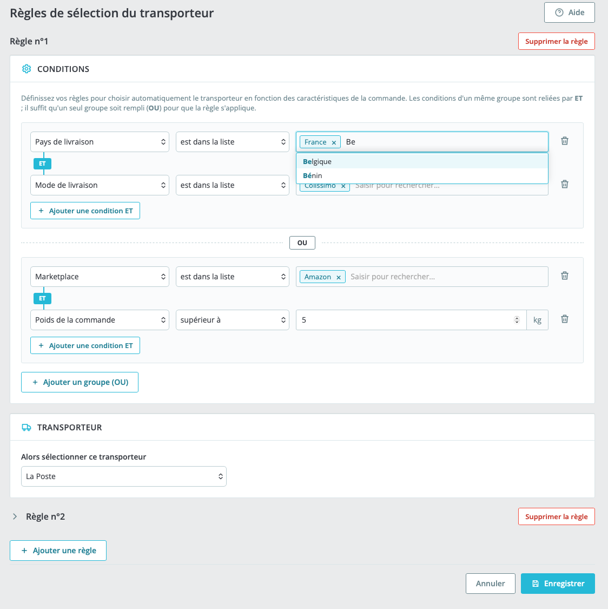

# Spec #34133 — Carrier selection rules

| | |
|---|---|
| Ticket | #34133 |
| Type | Feature |
| Estimate | 3 days dev (unit tests included) + 1 day project management / QA |

## 1. Context and need

Today, when an order is imported, the PrestaShop carrier is picked through a simple mapping **(marketplace, marketplace delivery mode) → PrestaShop carrier**, stored in `ps_shoppingfeed_carrier` and configured in *Shoppingfeed > Orders feeds* (carriers matching).

Merchants need to pick a different carrier for the same delivery mode depending on the order, first of all on the **shipping country**. Example:

| Country | Marketplace delivery mode | PrestaShop carrier |
|---|---|---|
| France | Amazon_Colissimo | Colissimo |
| Spain | Amazon_Colissimo | La Poste Espagne |

The solution is a **rule engine configured by the merchant**: "if conditions … are met, then select carrier X".

## 2. Scope

### In scope

- A **"Use the advanced carrier rules engine"** option in the Shoppingfeed module configuration (*Orders feeds* page). When enabled, the carriers matching view is replaced by the carrier selection rules view.
- The carrier selection rules configuration screen.
- Applying the rules during order import.
- Unit tests.

### Out of scope

- **No migration** of existing mappings (`ps_shoppingfeed_carrier`) to rules. As long as the option is disabled, current behavior is unchanged.

## 3. Functional model

### 3.1 Rule

A rule = a **token** + a set of **conditions** + a target **carrier** ("Then select this carrier").

- **Token**: in Shoppingfeed, multistore is handled through tokens (`ShoppingfeedToken`): one token = one shop + one language + one currency. A rule applies only to orders imported with its token (`conveyor['id_token']`).
- Rules are ordered (Rule #1, #2, …). On import, the rules of the order's token are evaluated in order and **the first rule whose conditions are met determines the carrier**.

### 3.2 Conditions: AND groups joined by OR

To avoid any AND/OR precedence ambiguity, conditions are organized in **groups**:

- within a group, conditions are joined by **AND** (all must be true);
- groups are joined by **OR** (one matching group is enough for the rule to apply).

In other words, a rule's conditions form a disjunctive normal form expression: `(A AND B) OR (C AND D)`.

Help text displayed under "Conditions": *"Define your rules to automatically choose the carrier based on the order's characteristics. Conditions within a group are joined by AND; a single matching group (OR) is enough for the rule to apply."*

### 3.3 Criteria

| Criterion | Source in the order | Value input |
|---|---|---|
| Marketplace | channel name (`$apiOrder->getChannel()->getName()`) | tags with suggestions (known marketplaces, see `ShoppingfeedCarrier::getAllMarketplaces()`) |
| Shipping country | shipping address country (ISO, after normalization by `OrderData`) | tags with suggestions (PrestaShop countries) |
| Delivery mode | marketplace carrier (`shipment.carrier`) | tags with suggestions (known modes, see `ShoppingfeedCarrier::getAllCarriers()`) |
| Order weight | see 3.5 | numeric, unit = shop weight unit (`PS_WEIGHT_UNIT`) |

### 3.4 Operators

| Operator | Text criteria (marketplace, country, delivery mode) | Weight |
|---|---|---|
| contains | ✓ | |
| equals | ✓ | |
| is in list | ✓ (typing a few characters shows suggestions) | |
| is not in list | ✓ (same) | |
| strictly greater than | | ✓ |

Text comparisons are case insensitive.

### 3.5 Order weight

Order weight = Σ (unit weight × quantity) over the order items mapped to a PrestaShop product (`conveyor['prestashopProducts']`), where:

- unit weight = `Product::weight` for a simple product;
- unit weight = `Product::weight + Combination::weight` for a combination (the combination weight is an **impact** on the product weight, not an absolute value);
- an item not mapped to a PrestaShop product counts as 0.

## 4. User interface

Validated mockup:

### 4.1 Switch

On the *Orders feeds* page (`AdminShoppingfeedOrderImportRules`), carriers section:

- a **"Use the advanced carrier rules engine"** switch (yes/no);
- **disabled**: current carriers matching view, unchanged;
- **enabled**: the carriers matching table is replaced by the carrier selection rules view;
- in both cases, the **default carrier** field (`SHOPPINGFEED_ORDER_DEFAULT_CARRIER_REFERENCE`) stays displayed.

### 4.2 Rules view

- Title "Carrier selection rules", "Help" button.
- One collapsible card per rule ("Rule #X") with a "Delete rule" button.
  - **Token** select (not on the mockup, to be added at the top of the card): lists the active tokens (`ShoppingfeedToken::findAllActive()`), labelled with shop / language / currency.
  - **Conditions** block: condition groups. Each row = criterion (select) / operator (select depending on the criterion) / value (tags with autocomplete, or numeric field + unit for weight) / trash icon. "AND" badge between rows of a group, "+ Add AND condition" button per group, "OR" separator between groups, "+ Add group (OR)" button.
  - **Carrier** block: "Then select this carrier" (select of PrestaShop carriers, same source as the current matching: `AdminShoppingfeedOrderImportRules::getAvailableCarriers()`).
- "+ Add rule", "Cancel", "Save".

## 5. Import behavior

Affected step: `ShoppingfeedOrderImportActions::verifyOrder()`, "Step 1/11 : Carrier retrieved" (same place as the current carrier resolution). At that point `conveyor['orderData']`, `conveyor['prestashopProducts']` and `conveyor['id_token']` are available.

Carrier resolution order when the advanced engine is **enabled**:

1. Specific rules through `onCarrierRetrieval` (unchanged: a specific rule that sets the carrier keeps priority).
2. **Carrier selection rules** of the order's token: first matching rule.
3. No match → module default carrier (`SHOPPINGFEED_ORDER_DEFAULT_CARRIER_REFERENCE`), then `PS_CARRIER_DEFAULT`.

The `ShoppingfeedCarrier` mapping is not used to resolve the carrier in this mode. However, `ShoppingfeedCarrier` entries are still created automatically for unknown (marketplace, delivery mode) pairs: they feed the marketplace / delivery mode suggestions, and keep the carriers matching up to date if the engine is disabled again.

When the advanced engine is **disabled**: current behavior strictly unchanged (`CarrierFinder::getCarrierForOrderImport`).

The import log must state which rule was applied, or that none matched.

## 6. Technical design

- **Switch**: new global configuration key `SHOPPINGFEED_ORDER_CARRIER_ADVANCED_RULES` (constant on `Shoppingfeed`, read/written with `Configuration::getGlobalValue()` / `updateGlobalValue()`): one setting for the whole module, not per shop or per token.
- **Storage**: new table `shoppingfeed_carrier_rule` through an ObjectModel (`ShoppingfeedCarrierRule`) installed with `ModuleInstaller` in a new `upgrade/install-X.Y.Z.php`:
  - `id_shoppingfeed_carrier_rule`
  - `id_shoppingfeed_token`
  - `position`
  - `conditions` (JSON: `groups[] → conditions[] { criterion, operator, value }`)
  - `id_carrier_reference`
  - `date_add`, `date_upd`
- **Carrier**: stored by `id_carrier_reference` (like the current mapping) so it survives carrier edits.

## 7. Tests

In `202/tests/OrderImport/`, following `OrderImportSimpleTest` (JSON dataset + `ActionsHandler`):

- engine disabled → same result as current mapping;
- one AND group (country + delivery mode) → expected carrier;
- two OR groups → the second group alone is enough;
- each operator (contains, equals, is in list, is not in list, strictly greater than for weight);
- weight of a combination = product weight + combination impact;
- rule order: the first matching rule wins;
- a rule attached to another token is ignored;
- no rule matches → default carrier.

## 8. Implementation (2.6.0)

Switch `Shoppingfeed::ORDER_CARRIER_ADVANCED_RULES`, default off; off ⇒ import behaves exactly as before via `CarrierFinder::getCarrierForOrderImport()`.

### Data

`ShoppingfeedCarrierRule` rows, per token and ordered by `position`, pointing to a carrier by `id_carrier_reference`. `conditions` is JSON in DNF: `{"groups":[{"conditions":[{criterion, operator, value}]}]}` = OR of AND groups; an empty group never matches.

### Classes (`src/CarrierRule/`)

- `OrderCriteria`: marketplace, country ISO, delivery mode, weight.
- `OrderWeightCalculator`: Σ (product + combination weight) × qty, unit `PS_WEIGHT_UNIT`.
- `ConditionEvaluator`: criteria/operators constants, `getOperatorsByCriterion()`, case-insensitive text matching; malformed data ⇒ false, never a warning.
- `CarrierRuleResolver`: first matching rule whose carrier still loads; rules with a deleted carrier are reported as skipped.
- `CarrierSelection`: chosen carrier + applied rule number + skipped rules, for logging.
- `CarrierRuleFormHandler`: admin input normalization/validation, save, `toFormData()`.

### Import

Carrier selection lives in one place, `CarrierFinder::selectCarrierForOrderImport()` (reads the switch, returns a `CarrierSelection`); `verifyOrder()` only calls it and logs the result. An `onCarrierRetrieval` specific rule that sets the carrier keeps priority.

- Switch on ⇒ the rules replace the mapping entirely (the `ShoppingfeedCarrier` mapping is not consulted); no match ⇒ `getDefaultCarrierForOrderImport()` (module default carrier, then `PS_CARRIER_DEFAULT`).
- Switch off ⇒ `getCarrierForOrderImport()` (mapping, then the same default).
- `ShoppingfeedCarrier` rows are still auto-created for unknown (marketplace, delivery mode) pairs in both modes (unless a specific rule sets `skipSfCarrierCreation`).

Carrier-dependent specific rules must not guess the carrier with `getCarrierForOrderImport()` (that ignores the rules engine): use `onVerifyOrder`, which receives the selected carrier in `$params['carrier']` and still runs before the addresses are created (`ColissimoRule`, `ManomanoDpdRelais`), or check `$cart->id_carrier` in `afterCartCreation` (`GlsRule`, `MondialrelayRule`).

### Admin

Carrier section of `AdminShoppingfeedOrderImportRules` (`saveCarrierRules()`, data passed to JS as `shoppingfeedCarrierRules`), `views/templates/admin/shoppingfeed_order_import_rules/carrier_rules.tpl`, `views/js/order_import/carrier_rules.js` (plain ES5 + jQuery, posts all rules as one JSON field `shoppingfeed_carrier_rules`), `views/css/shoppingfeed_configuration/carrier_rules.css`.

### Tests

`202/tests/OrderImport/CarrierRule*Test.php`, `CarrierFinderSelectionTest.php`, `CarrierDependentRulesTest.php`, `OrderImportCarrierRulesTest.php`; shared fixtures (rules, handler, module carrier) in `CarrierRuleFixturesTrait`.
